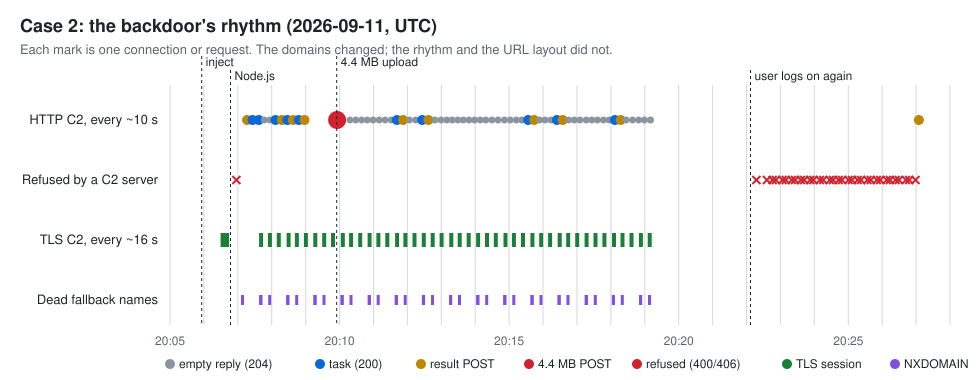
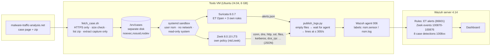

# Network Threat Detection & Packet Capture Investigations

**Suricata + Zeek → Wazuh · three real malware captures · behaviour-based detections, tested against clean traffic**

Three real infections, investigated from their network traffic the way a SOC analyst would: find the infected machine and its user, rebuild the timeline, extract the indicators, map them to MITRE ATT&CK, and turn what the attacker *did* into detection rules. Every rule is tested two ways: it must fire on its own capture with the exact expected count, and stay silent on a clean capture and on the other two cases.

| | |
|---|---|
| **Investigations** | Lumma Stealer (information theft), KongTuke ClickFix + Node.js backdoor, a remote access trojan over a fake HTTPS port |
| **Answer keys** | **17 of 17** official questions answered correctly (7/7, 5/5, 5/5), with the keys opened only after each report was final |
| **Detections** | **11 behaviour rules** (3 Suricata, 8 Wazuh on Zeek logs): **11/11 pass**, exact counts, **0 false alarms** on the clean baseline and the other cases |
| **Indicators** | 43 indicators, all defanged, each with role, status, reputation and domain age |
| **Key finding** | Reputation services missed the attack where it mattered: the main C2 server of case 2 scored **0/92** on VirusTotal and every C2 IP had 0 AbuseIPDB reports. What gave each attack away was **behaviour** (rhythm, direction and size of traffic, protocol mismatch) and **domain age** (most inject, stage and C2 domains were registered 0–14 days before the infection) |
| **Safety** | Captures never leave a locked VM disk; sensors run in a sandbox **with no network at all**; no malware file is ever written to disk, and hashes are computed in memory |

Everything is free to run: open-source tools, free rulesets, free API tiers.

---

## Contents

1. [The three investigations](#the-three-investigations)
2. [Architecture](#architecture)
3. [Detections and test results](#detections-and-test-results)
4. [Reputation versus behaviour](#reputation-versus-behaviour)
5. [Design decisions and why](#design-decisions-and-why)
6. [Safety](#safety)
7. [Known limits](#known-limits)
8. [Lessons learned](#lessons-learned)
9. [Run it yourself](#run-it-yourself)
10. [Repository layout](#repository-layout)
11. [Credits and licences](#credits-and-licences)

---

## The three investigations

Each report follows the same structure ([template](investigations/_template/REPORT.md), [method](docs/METHODOLOGY.md)): executive summary, victim, timeline with evidence, findings, indicators, ATT&CK mapping, detections with live results, recommendations, and an honest **"What I missed"** section written after reading the official answer key.

### Case 1: Lumma Stealer from a fake file download → [report](investigations/case-1/REPORT.md)

A Google Drive link led to look-alike file-hosting sites and a 15.9 MB download. Within 30 seconds Lumma Stealer:
1. **opened the user's own Chrome and Edge** on its server's page, to collect browser fingerprints;
2. **uploaded 2.06 MB** in three encrypted sessions;
3. contacted two `.cc` domains registered days earlier;
4. resolved the name of every group in the domain 12 times in 3 seconds (suspected discovery).

The victim's full name came from an unencrypted SAMR reply, while LDAP was sealed.

### Case 2: KongTuke web inject → ClickFix → Node.js backdoor → [report](investigations/case-2/REPORT.md)

A tampered website loaded an inject from a domain registered **that same day**. After a 33-second pause, most likely the user pasting a command, the machine downloaded about 45 MB of tools, **including the official Node.js runtime**, and started a backdoor with two C2 channels:
- HTTP every ~10 s, with a fixed URL layout and a 64-hex victim token;
- TLS every ~16 s, rotating six domains, three of them dead.

It sent **4.4 MB in one POST**, survived a new logon, then tried seven fallback servers, all of which refused it.

<p align="center"></p>

### Case 3: A curl chain and a RAT on a fake HTTPS port → [report](investigations/case-3/REPORT.md)

After a Google search and a same-day inject domain, the attack ran entirely through **curl**, not the browser:
1. two script stages;
2. then `runner_ilove.exe`, fetched from a bare IP on port 9000 (VirusTotal 45/70);
3. **DNS-over-HTTPS** to look up the server out of the company DNS's sight;
4. a **37-minute connection on port 443 that is not TLS**: 13.4 MB down in 18 seconds, then a one-byte heartbeat every 20 s.

The program's SHA-256 was rebuilt **in memory** and confirmed three ways: Zeek, the rebuild, and VirusTotal.

| Case | Victim | Answer key | Indicators | Custom rules (fire here / false alarms elsewhere) |
|---|---|---|---|---|
| 1 | 10.1.21.58 · DESKTOP-ES9F3ML · gwyatt (Gabriel Wyatt) | **7/7** | 12 | 3 rules: 2 / 3 / 1 hits, 0 elsewhere |
| 2 | 10.9.11.135 · DESKTOP-6T17ZFM · gmcdowell (Gabriel McDowell) | **5/5** | 20 | 4 rules: 99 / 1 / 1 / 1 hits, 0 elsewhere |
| 3 | 10.10.1.128 · DESKTOP-4VGYQX7 · bdiaz | **5/5** (SHA-256 exact) | 11 | 4 rules: 1 / 1 / 2 / 1 hits, 0 elsewhere |

These are fictional lab identities created by the exercise author.

---

## Architecture



A full walk-through, with every test result, is in [docs/PIPELINE.md](docs/PIPELINE.md). In short:

1. **Download inside the VM.** `fetch_case.sh` accepts HTTPS from this one site only, checks the size against the case page to the byte, and lists the zip before opening it. It refuses any zip that holds anything other than exactly one capture.
2. **Locked storage.** Captures sit on their own disk mounted `noexec`, so nothing there can run, and they are read-only.
3. **Sandboxed sensors.** `analyze_pcap.sh` runs Suricata and Zeek as an unprivileged user in a systemd sandbox with **no network interface except loopback**. Each run goes to a new, time-stamped folder with a `run-info.json` recording the capture hash, the sensor versions and the ruleset date.
4. **Shipping to Wazuh.** `publish_logs.py` hands the logs to the Wazuh agent in the way it needs (see [decision 9](#9-a-publish-step-for-the-wazuh-agent)). `check_ingest.sh` proves nothing was lost: every run it checked reached Wazuh line for line.
5. **Analysis.** Zeek logs with `jq`, Suricata alerts, `tshark` inside the same sandbox, Wireshark for the visuals, and the Wazuh dashboard.

---

## Detections and test results

Each rule detects a **behaviour** seen in a case, not a domain or IP the attacker can change tomorrow. Each was written **after measuring** the behaviour across all four captures, and each has a comment block explaining what it detects, why, and what could cause a false alarm. Definitions: [Suricata](detections/suricata/local.rules) · [Wazuh](detections/wazuh/nsm_rules.xml) · [conventions](detections/README.md).

Live test (`scripts/test_detections.py`, latest run of every capture, 2026-10-22):

| Rule | Detects | Clean baseline | Case 1 | Case 2 | Case 3 | Result |
|---|---|---|---|---|---|---|
| Suricata 1004001 | Lumma-style browser fingerprint upload (`POST /api/set_agent?…&act=log`) | 0 | **2** | 0 | 0 | PASS |
| Wazuh 100801 | Upload-heavy TLS session (≥ 200 KB out, < 100 KB back, outside host) | 0 | **3** | 0 | 0 | PASS |
| Wazuh 100803 | 100+ LSA name lookups from one host in 10 s (group discovery) | 0 | **1** | 0 | 0 | PASS |
| Suricata 1004101 | Backdoor C2 path: random path + `&` + 64-hex token | 0 | 0 | **99** | 0 | PASS |
| Wazuh 100822 | Plain-HTTP POST ≥ 1 MB to an outside host | 0 | 0 | **1** | 0 | PASS |
| Wazuh 100821 | 20+ empty (204) replies from one host in 5 min (beacon) | 0 | 0 | **1** | 0 | PASS |
| Wazuh 100824 | Same name fails to resolve 10+ times in 5 min (dead fallback C2) | 0 | 0 | **1** | 0 | PASS |
| Suricata 1004201 | Non-TLS traffic to TCP 443 (protocol detection failed) | 0 | 0 | 0 | **1** | PASS |
| Wazuh 100840 | curl / wget / PowerShell downloads a Windows program | 0 | 0 | 0 | **1** | PASS |
| Wazuh 100841 | Command-line HTTP request from a workstation (visibility) | 0 | 0 | 0 | **2** | PASS |
| Wazuh 100842 | DNS-over-HTTPS from a client | 0 | 0 | 0 | **1** | PASS |

Every count is explained by the evidence: for example, 1004001 fires twice because two browsers (Chrome, Edge) each posted one fingerprint. The rules' logic is also unit-tested with 31 sample events, including look-alikes that must **not** match (`wazuh/logtest.py`, 31/31).

**ATT&CK coverage of the custom rules**

| Technique | Rules |
|---|---|
| T1041 Exfiltration Over C2 Channel | 1004001, 100801, 100822 |
| T1071.001 Application Layer Protocol: Web | 1004101, 100821 |
| T1071.004 Application Layer Protocol: DNS (DoH) | 100842 |
| T1008 Fallback Channels | 100824 |
| T1069.002 Permission Groups Discovery: Domain Groups | 100803 |
| T1105 Ingress Tool Transfer | 100840 (+ visibility rule 100880 for any Windows program in Zeek) |
| T1571 Non-Standard Port / T1095 Non-Application Layer Protocol | 1004201 |

---

## Reputation versus behaviour

The most useful finding of the project, checked on 2026-10-22 by name, address or hash only:

| Case | What reputation said | What actually gave it away |
|---|---|---|
| 1 | Payload host **1/92** on VirusTotal; three server IPs, **0** AbuseIPDB reports | three uploads with tiny replies; the malware driving real browsers; contacted domains registered 5–42 days before |
| 2 | Main C2 domain **0/92**; seven fallback servers 0/92; all IPs **0** reports | a beacon every 10 s with 52 empty replies; a fixed URL layout; a 4.4 MB POST; the same dead names failing 15 times |
| 3 | Script host **0/92**, RAT server **7/92** | curl instead of a browser; a program from a bare IP on port 9000; DoH; a non-TLS session on 443 |

Reputation is still worth checking: the program in case 3 was 45/70, and it is fast evidence for a report. But in all three cases it was **late or silent for the infrastructure that mattered**, while the behaviour was visible from the first minute.

---

## Design decisions and why

These are the decisions that shape the project, each with its reason and, where there was one, the alternative that was considered.

### 1. Two sensors, Suricata *and* Zeek
| | |
|---|---|
| **Decision** | Run both on every capture. |
| **Why** | They answer different questions. Suricata matches traffic against ~53,000 known-bad patterns ("is this known?"). Zeek records what happened, as structured logs ("what exactly happened, in order?"). Every custom Wazuh rule in this project is built on Zeek fields (byte counts, status codes, DNS answers, DCE-RPC operations) that a signature engine does not log. Both write a **Community ID**, so one alert links to its full connection record. |
| **Alternative** | Suricata alone with its protocol logs. Simpler, but Zeek's `conn.log`, `dce_rpc.log` and file hashing made three of the eight Wazuh detections possible. |

### 2. Offline analysis only, never replay
| | |
|---|---|
| **Decision** | Read captures with `-r`; never send them onto a network (`tcpreplay`). |
| **Why** | The traffic contains real criminal servers' addresses. Replaying could reach them or trip outside alarms. Offline reading gives the same logs. |

### 3. A sandbox with no network for the sensors
| | |
|---|---|
| **Decision** | Suricata, Zeek and tshark run as user `nsm` (no shell, no sudo) inside a transient systemd unit: `PrivateNetwork`, `ProtectSystem=strict`, no capabilities, 3 GB / 30 min limits. |
| **Why** | These programs parse traffic written by criminals. A parser bug must not reach an account with sudo, or the network. Tested: internet unreachable by name and by IP (only `lo` exists), system read-only, home folders hidden, sudo refused. |
| **Alternative** | Running as the analyst's user is the common default, and the risk is small. The cost of doing better was one 40-line script. |

### 4. A separate `noexec` disk for captures
| | |
|---|---|
| **Decision** | A 10 GB LVM volume at `/srv/cases`, mounted `noexec,nosuid,nodev`; captures read-only (0440). |
| **Why** | Some downloads on the source site include malware. Nothing stored there can run, even with the executable bit set (tested: exit 126), and a full case disk can't fill the system disk. |

### 5. Captures never touch Windows; malware files never touch any disk
| | |
|---|---|
| **Decision** | Download and unzip inside the Linux VM. Never use "Export Objects" or file carving. Compute hashes in memory, or take them from Zeek. Look up hashes, never upload files. |
| **Why** | A Windows program can't run on the Linux VM, and nothing we don't need exists on disk. In case 3, the official answer exports the program with Wireshark; we got the **identical SHA-256** without it ever being written anywhere. |

### 6. Vendor packages, pinned, from scoped sources
| | |
|---|---|
| **Decision** | Suricata 8.0.7 from the OISF PPA, and Zeek 8.0.10 LTS (`zeek-8.0-core` only) from the Zeek project's openSUSE repository. Both held with `apt-mark`. Each extra source is pinned so it can only provide its own packages, and the Zeek key is scoped with `Signed-By`. |
| **Why** | Ubuntu's archive only has Suricata 7.0.3, at or near end of life, and no Zeek at all. Pinning keeps a third-party source from ever replacing an Ubuntu package. Holding keeps results reproducible, and every run records its versions. |
| **Alternative** | Docker images. Rejected: one more layer to secure, and the host RAM is the limit in this lab. |

### 7. An own Zeek policy instead of the default
| | |
|---|---|
| **Decision** | `ntd.zeek` is the default site policy with three changes: `detect-MHR` removed, MAC and Community ID logging added, and SHA-256 added for every file. |
| **Why** | `detect-MHR` sends **every file hash** to an outside DNS service (Team Cymru). Our rule is that nothing leaves the lab unless we decide it. Zeek 8.0's default hashing stops at SHA-1, but reports and threat intelligence use SHA-256: case 3 exposed this when `files.log` had no SHA-256 for the program. |

### 8. Seven checksum rules turned off, with the reason written down
| | |
|---|---|
| **Decision** | Disable ET's checksum decoder rules (2200073–79) through `suricata-disable.conf`. |
| **Why** | On our own clean capture, **6,920 of 6,940 alerts** were checksum errors. A capture taken on the sending machine sees packets before the network card fills in their checksums ("checksum offloading"). These alerts carry no security meaning offline. Every disabled rule is a blind spot, so the list is short and each entry says why. |

### 9. A publish step for the Wazuh agent
| | |
|---|---|
| **Decision** | `publish_logs.py`: create the watched files empty, wait for the agent's "New file that matches" message, then write the lines at ≤ 300 per second. Every run goes to a new time-stamped folder. |
| **Why** | Three agent behaviours were found by testing, not by reading docs: <br/>• it reads a newly found file **from the end**: our first complete logs reached Wazuh with **0 events**; <br/>• its queue drops lines past 1,024; <br/>• it remembers every path it has seen, even deleted ones, and ignores a reused folder. <br/>The fix works around all three without touching agent internals, and `check_ingest.sh` proves the result. |

### 10. Behaviour over indicators, thresholds from data
| | |
|---|---|
| **Decision** | Rules target what the malware *does*. Every threshold comes from measuring the behaviour in all four captures first. |
| **Why** | Indicators changed constantly in these cases (7 fallback C2 domains in case 2 alone). Measuring first caught two bad ideas: <br/>• "the same failed DNS lookup repeated" would have fired in **every** capture on Windows' own `wpad` lookups (13–20 per capture), so `wpad`, `isatap` and SRV names are excluded; <br/>• "connection longer than 30 minutes" would have flagged **two genuine Microsoft connections** in case 3, so the RAT is caught by "not TLS on 443" instead. |

### 11. Exact counts in tests, not "fired at least once"
| | |
|---|---|
| **Decision** | `expected.json` requires the exact number of hits where the evidence explains it (99 C2 requests, 3 uploads, 2 fingerprints), and 0 hits on every other capture. |
| **Why** | "Fired at least once" would hide a rule that fires too often. A rule that fires 200 times for 99 requests is broken even if it "works". |

### 12. Answer keys only after the report is final
| | |
|---|---|
| **Decision** | Keep the official answers closed until a report is complete. Then compare item by item in a "What I missed" section, and never change the earlier sections. |
| **Why** | It's the only honest way to measure the analysis. Result: 17/17, plus two errors found **in** the keys (a mistyped victim IP in case 1, a mistyped server IP in case 3), each checked against the traffic. |

### 13. Reputation lookups: names, addresses and hashes only
| | |
|---|---|
| **Decision** | Reuse the lookup code of Project 2, the AI Phishing Triage Assistant (VirusTotal, AbuseIPDB, RDAP domain age) with its existing keys, which stay in that project's `.env`. Never submit URLs or files. Never use services that *visit* an address (urlscan.io). |
| **Why** | Looking something up must not touch the attacker's server or leak the victim's data. RDAP's registration date turned out to be the strongest outside signal in all three cases. |

### 14. Defang everything; credit, don't copy
| | |
|---|---|
| **Decision** | Every indicator in the repository is defanged, including machine-readable files. Captures, the site's text and its answer keys are never redistributed: each report links to its case page. |
| **Why** | A public repository must not contain clickable malware links. The source site gives no licence for redistribution. |

---

## Safety

The full rules are in [docs/SAFETY.md](docs/SAFETY.md). In short:

- Real malware traffic is handled **only inside a Linux VM**, on a disk where nothing can run.
- The analysis tools are **sandboxed with no network**.
- **No malware file is ever extracted**; hashes are computed in memory.
- **No indicator is ever visited**: lookups go by name, address or hash, to services that answer from their own data.
- **Every indicator is defanged** in the repository, checked by `scripts/prepublish_scan.py` before publishing; test data uses documentation addresses (RFC 5737) instead of real attacker IPs.

---

## Known limits

- **Four captures are not proof of a low false-positive rate.** 0 false alarms here means the rules separate these attacks from this clean traffic. In a real network some rules would need allowlists: upload services for 100801, polling apps for 100821, VPN clients on 443 for 1004201, developers' curl for 100840/100841, and browsers with "secure DNS" for 100842. Each rule's comment names its likely false alarms.
- **The clean baseline is Linux traffic.** It is 90 seconds of ordinary activity on the tools VM, not a Windows office network. The other two cases act as a second, Windows-based check, but a longer Windows baseline would be better.
- **Encrypted content stays encrypted.** The ClickFix steps (cases 2 and 3) and what was stolen (cases 1 and 2) are inferred from timing and sizes, and marked *suspected* where the traffic can't prove them.
- **Replay timing.** Wazuh counts frequency rules by arrival time. Live, that equals traffic time; in our replay the lines arrive faster. The thresholds were checked to fire in both conditions, but replay alone cannot prove the 5-minute windows under live conditions.
- **ET Open, not ET Pro.** The family signature named in case 3's scenario ("CNCmachineRMS") is not in the free ruleset. Our behaviour rule caught the channel anyway.
- **No live sensor (planned M7, not built).** The lab network has no real users, so a live sensor would only see test traffic, and Project 3 already covers alert-to-response automation. The rules are sensor-agnostic and would work on live Suricata/Zeek output unchanged.
- **Screenshots:** the case 1 walkthrough ([REPRODUCE.md](investigations/case-1/REPRODUCE.md)) shows how to reproduce every finding in Wireshark.

## Lessons learned

1. **Test the plumbing, not just the rules.** The pipeline "worked" and delivered nothing: the Wazuh agent silently skipped complete files. Only a line-by-line count (`check_ingest.sh`) showed it.
2. **Wazuh frequency rules ignore level-0 parents.** The group-discovery rule never fired until its parent rule was raised to level 1 (still below the alert log level, so nothing floods the dashboard).
3. **Verify every hash two ways.** A clever one-liner produced a wrong SHA-256 for the case 3 program. Comparing MD5 and SHA-1 with Zeek's caught it before it reached the report.
4. **Measure before writing a rule.** Two "obvious" detections (repeated NXDOMAIN, long connections) would have fired on normal Windows behaviour.
5. **Answer keys have errors too.** Two mistyped IPs in the official keys were caught because every answer was checked against the traffic.
6. **Shell quoting is a security tool's enemy.** Bash heredocs silently turned `\\` into `\` in test data twice, so fixtures and scripts with backslashes are now written by Python.

---

## Run it yourself

Requirements: a Wazuh 4.x server with an agent on an Ubuntu 24.04 VM (the "tools VM"), about 6 GB RAM for the VM, and SSH with a key. The paths and IPs below are this lab's; adjust `scripts/deploy.sh`.

```bash
# on the tools VM, once: locked storage, sandbox user, sensors (prints exact download size first)
sudo bash tools-vm/setup_storage.sh
sudo bash tools-vm/install_sensors.sh --plan
sudo bash tools-vm/install_sensors.sh --install

# from the laptop (Git Bash), in this folder: push scripts and rules, install them on both VMs
bash scripts/deploy.sh all

# on the tools VM: fetch a case safely, analyse it in the sandbox
bash ~/ntd/tools-vm/fetch_case.sh case-1 https://www.malware-traffic-analysis.net/2026/01/31/2026-01-31-traffic-analysis-exercise.pcap.zip 21724195
sudo bash ~/ntd/tools-vm/analyze_pcap.sh case-1

# from the laptop: prove every line reached Wazuh, then test every rule on every capture
bash scripts/check_ingest.sh case-1-<UTC time of the run>
python -I scripts/test_detections.py
```

Before publishing, `python -I scripts/prepublish_scan.py` checks every tracked file for live (non-defanged) indicators, links to non-allowlisted sites, secrets and e-mail addresses (0 findings on 2026-10-22). `make_baseline.sh` records the clean comparison capture. `ntshark.sh` runs tshark in the sandbox. `lookup_iocs.py` checks reputation by name, address or hash only (it needs Project 2's lookup code and keys).

## Repository layout

| Path | Contents |
|---|---|
| `investigations/case-1…3/` | `REPORT.md`, `iocs.csv` (defanged), reputation lookups; case 1 also has a Wireshark walkthrough (`REPRODUCE.md`) |
| `investigations/_template/` | Report and IOC templates |
| `detections/` | Suricata rules (`suricata/local.rules`), Wazuh rules (`wazuh/nsm_rules.xml`), tests (`tests/`), conventions |
| `tools-vm/` | Everything that runs on the sensor VM: storage, sandbox, installer, fetch, analysis, publish step, Zeek policy, agent config |
| `wazuh/` | Rule installer with a pre-check and rollback; logtest socket client |
| `scripts/` | Deploy, ingestion check, detection tests, reputation lookups, pre-publish scan, figure generator |
| `docs/` | [Pipeline](docs/PIPELINE.md), [method](docs/METHODOLOGY.md), [safety rules](docs/SAFETY.md), [case selection](docs/CASE_SELECTION.md), figures |

## Credits and licences

- **Captures and exercises:** Brad Duncan, [malware-traffic-analysis.net](https://www.malware-traffic-analysis.net/). Not redistributed here; each report links to its case page. The reports are our own analysis and do not reproduce the site's text or answer keys.
- [Suricata](https://suricata.io) (GPLv2) by OISF; [Emerging Threats Open](https://rules.emergingthreats.net/) ruleset by Proofpoint, fetched with `suricata-update` and not redistributed.
- [Zeek](https://zeek.org) (BSD licence); [Wireshark / tshark](https://www.wireshark.org) (GPLv2).
- [Wazuh](https://wazuh.com) (GPLv2): SIEM, the stock Suricata rules (86600/86601).
- Lookups: [VirusTotal](https://www.virustotal.com) (free public API, non-commercial use), [AbuseIPDB](https://www.abuseipdb.com), RDAP through [rdap.org](https://rdap.org).

## Lab

VMware NAT network 192.168.145.0/24: Wazuh 4.14 server (.128) and an Ubuntu 24.04 tools VM (.20) running the sensors. The same tools VM runs Project 3's n8n pipeline. Nothing is exposed to the internet.
