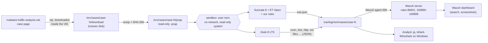

# How the analysis pipeline works

This page explains, step by step, what happens to a capture from download to Wazuh, and why each piece is there. Read it once before case 1. Each "why" is something an interviewer may ask.

## The picture



## Step by step

### 1. Download inside the tools VM

The zip is fetched with `curl` **on the tools VM**, never in a Windows browser. Some zips on the site contain malware next to the capture; on Windows, Defender would quarantine them and a wrong double-click would be the worst case. On Linux, a Windows program cannot run.

`tools-vm/fetch_case.sh` does the download: HTTPS only, from this one site only, and it checks that the size matches the case page to the byte. Then `extract_pcap.py` **lists the zip before opening anything**. It refuses any zip that holds something other than exactly one `.pcap`/`.pcapng`, writes the capture under a name we choose (a path stored in a zip can point outside the folder, the "zip slip" trick), stops past 2 GB (zip bomb guard), and records the SHA-256 of both the zip and the capture in `case-info.json`.

### 2. A separate disk that cannot run programs

`/srv/cases` is its own 10 GB disk (an LVM logical volume), mounted with three options:

| Option | Meaning |
|---|---|
| `noexec` | Nothing stored there can be run as a program, even if someone sets the "executable" flag. Tested: a test script stored there was refused (exit code 126) |
| `nosuid` | A program can't gain extra rights from a file stored there |
| `nodev` | No device files |

The capture is set read-only after unzipping (`chmod 0440`), and its SHA-256 is recorded, so the report can prove which file was analysed.

### 3. The sandbox

Suricata and Zeek read hostile data: the packets were written by criminals. These programs are well tested, but a bug in a parser could in theory let crafted traffic run code. So they never run as `fathia` (who has sudo). They run as **`nsm`**, a system user with no password, no shell and no sudo, inside a temporary systemd unit (`tools-vm/lib_sandbox.sh`):

| Setting | Effect | Tested |
|---|---|---|
| `PrivateNetwork=yes` | The process gets its own empty network: only loopback. It cannot reach the internet or the lab | `curl` to a name and to `1.1.1.1` both fail; `ip link` shows only `lo` |
| `ProtectSystem=strict` | The whole file system is read-only, except the one output folder | Writing to `/var/log/nsm` fails: "Read-only file system" |
| `ProtectHome=yes` | Home folders are invisible | Listing `/home/fathia` fails |
| `NoNewPrivileges`, no capabilities | Can't become root, even through sudo | `sudo` refuses to run |
| `MemoryMax=3G`, `RuntimeMaxSec=1800` | A runaway analysis can't freeze the VM | — |

`tshark` runs in the same sandbox (`tools-vm/ntshark.sh`) for the same reason.

### 4. Two sensors, two views of the same traffic

| | Suricata | Zeek |
|---|---|---|
| What it is | Signature engine: compares traffic to tens of thousands of ET Open rules (exact count in `run-info.json`) | Network recorder: writes a structured log of everything that happened |
| Output | `eve.json`: alerts plus protocol events | One log per protocol: `conn.log` (every connection), `dns.log`, `http.log`, `ssl.log`, `files.log` (with hashes), `kerberos.log`, `dhcp.log`, ... |
| Answers | "Does this match something known to be bad?" | "What exactly happened, in order?" |
| Weakness | Silent on anything no rule knows | Doesn't judge; you must know what to look for |

Both write a **Community ID** for every connection: the same value in Suricata's alert and in Zeek's `conn.log` line. That is how an alert is linked to its full connection record in one search.

**Zeek policy:** we don't use Zeek's default site policy (`local`) but our own copy, `tools-vm/ntd.zeek`. The default loads `detect-MHR`, which looks up the hash of every file in the traffic with an outside DNS service (Team Cymru). Our rule is that nothing leaves the lab, so it is removed. Ours also adds MAC addresses to `conn.log`, which helps identify the victim.

**Suricata rules:** ET Open has about 53,000 active rules. Seven are turned off (`tools-vm/suricata-disable.conf`): the checksum alerts. On our clean baseline they produced 6,920 of 6,940 alerts, all false. When you capture on the machine that sends the traffic, the network card fills in checksums *after* the capture point ("checksum offloading"), so every outgoing packet looks corrupt. `update_rules.sh` refreshes ET Open and applies this list; run it before each case.

**Each run gets its own folder**, named by case and UTC time: `/var/log/nsm/cases/case-1-20261021T211200Z/`. For convenience, `/var/log/nsm/latest/case-1` always points to the newest run. A `run-info.json` in the folder records the capture hash, the sensor versions, the ruleset date and the number of lines per log, which goes into the report header.

### 5. Into Wazuh

The tools VM's Wazuh agent (006) watches `/var/log/nsm/cases/*/...` and tags each line with labels (`nsm.sensor` = suricata or zeek, `nsm.log` = dns, http, ...). Wazuh gets the Suricata **alerts** (`suricata/alerts.json`) and the main Zeek logs; the full `eve.json` stays on the VM, since Zeek already ships the protocol details.

**Two agent behaviours we had to work around** (found 2026-10-21, good interview material):

| What the agent does | What went wrong | Fix in `tools-vm/publish_logs.py` |
|---|---|---|
| It starts reading a newly found file **from the end** | Our first run wrote complete logs: Wazuh received **nothing** | Create the files empty, wait until the agent's own log says it is watching them ("New file that matches"), then write the lines |
| Its internal queue holds 1,024 lines; extra lines are dropped | A big capture written at once would lose events silently | Write at most 300 lines per second |
| It remembers every path it ever watched, even after deletion | A re-run into a deleted-and-recreated folder was ignored | Folder names include the time, so they never repeat |

`scripts/check_ingest.sh <run>` proves nothing was lost: it counts the lines shipped per log on the VM and the alerts Wazuh stored for that run. The baseline: 266 of 266.

On the server:

| Rule | Level | What |
|---|---|---|
| 86601 (Wazuh's own) | 3 | Any Suricata alert |
| 100860 | 10 | One of **our** Suricata rules fired (SID 1004xxx) |
| 100870 | 0 | Any Zeek line (parent rule, not stored) |
| 100871–100875 | 3 | Zeek DNS, HTTP, TLS, files, DHCP/Kerberos/software: searchable in the dashboard |
| 100876 | 5 | Zeek notice (Zeek's own warnings, e.g. a bad certificate) |
| 100880 | 7 | A Windows program was transferred (visibility, ATT&CK T1105) |
| 100800–100859 | — | Case detections, written during the cases |

`conn.log` stays at level 0: there are thousands of lines per capture, and they are read directly with `jq` when needed.

One thing to know: in Wazuh the **alert time is when Wazuh read the line**, not when the traffic happened (the captures are weeks or months old). The real time is inside the event (`timestamp` for Suricata, `ts` for Zeek), and that is the time the reports use.

### 6. Testing the rules

`wazuh/logtest.py` sends sample events to the Wazuh server's test interface and compares the rule that matched with an expected list (`detections/tests/`). This tests the rule logic without waiting for real traffic. The real test then comes from the captures themselves (M3–M6).

## Commands you will use

```bash
# on the laptop, in the repo folder: push scripts and rules to the lab
bash scripts/deploy.sh all
bash scripts/check_ingest.sh case-1-20261021T211200Z     # did Wazuh get every line of that run?

# on the tools VM
bash ~/ntd/tools-vm/fetch_case.sh case-1 <zip-url> <bytes>  # download + safe extract (no sudo)
sudo bash ~/ntd/tools-vm/update_rules.sh                    # refresh ET Open
sudo bash ~/ntd/tools-vm/analyze_pcap.sh case-1             # run both sensors
sudo bash ~/ntd/tools-vm/ntshark.sh case-1 --capinfos        # capture summary
sudo bash ~/ntd/tools-vm/ntshark.sh case-1 -Y dhcp -T fields -e frame.time_utc -e dhcp.option.hostname
jq -r 'select(.event_type=="alert") | [.timestamp,.src_ip,.dest_ip,.alert.signature] | @tsv' \
    /var/log/nsm/latest/case-1/suricata/eve.json
```
